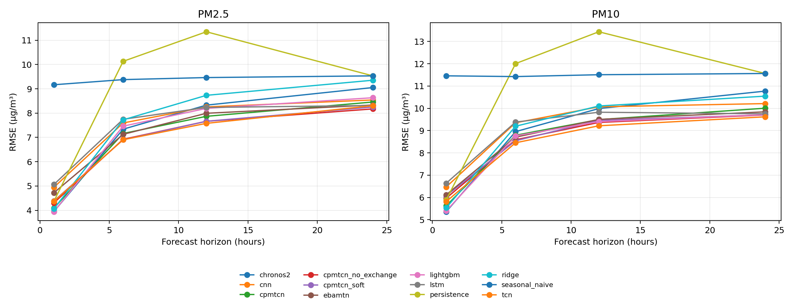
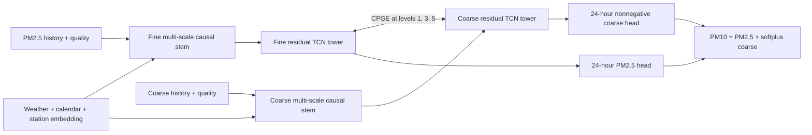
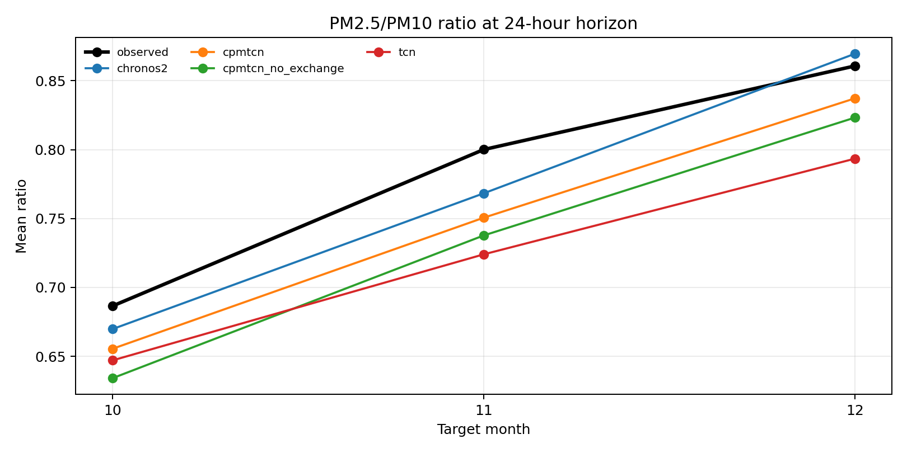
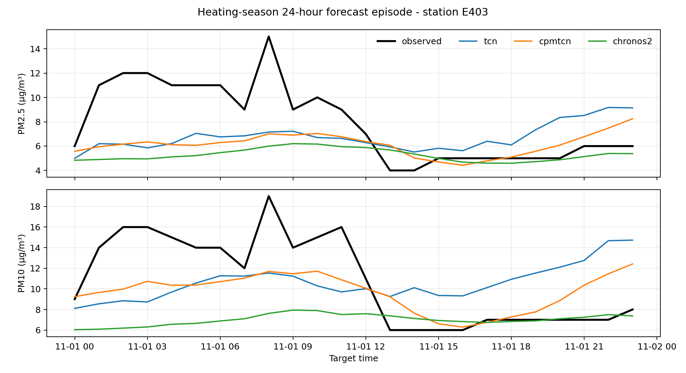
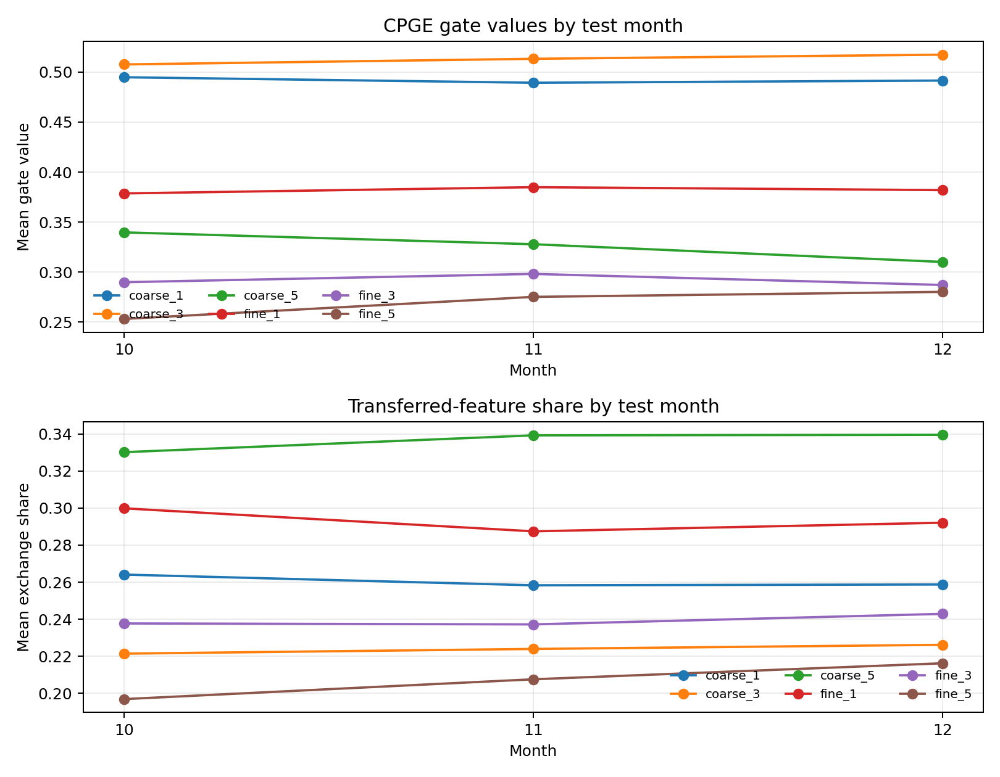

# Forecasting PM2.5 and PM10 and Mapping Cross-Pollutant Relations

An end-to-end, leak-aware hourly air-pollution forecasting study across 21 monitoring stations. The system uses the previous 168 hours to forecast PM2.5 and PM10 for each of the next 24 hours, compares statistical, tree, foundation, recurrent, convolutional, and cross-pollutant neural models, and tests when information from one particle fraction helps predict the other.

The project is complete and reproducible on a 6 GB NVIDIA RTX 3050. It includes data auditing, preprocessing, chronological splits, 12 forecasting families, 14 core neural runs, 24 controlled cross-value runs, two-seed ablations, significance tests, diagnostics, and interview-ready explanations of every design choice.



## Table of contents

1. [Thirty-second project explanation](#thirty-second-project-explanation)
2. [Problem and research questions](#problem-and-research-questions)
3. [Dataset and audit findings](#dataset-and-audit-findings)
4. [Forecasting protocol and chronological splits](#forecasting-protocol-and-chronological-splits)
5. [Leak-free preprocessing](#leak-free-preprocessing)
6. [Models](#models)
7. [Cross-pollutant architecture](#cross-pollutant-architecture)
8. [Loss, optimization, and hardware](#loss-optimization-and-hardware)
9. [Evaluation and statistical testing](#evaluation-and-statistical-testing)
10. [Results](#results)
11. [Cross-pollutant findings](#cross-pollutant-findings)
12. [Reproduce the project](#reproduce-the-project)
13. [Repository and output guide](#repository-and-output-guide)
14. [Interview preparation](#interview-preparation)
15. [Limitations and next steps](#limitations-and-next-steps)
16. [Reproducibility status](#reproducibility-status)
17. [References](#references)

## Thirty-second project explanation

> I built a multi-station, multi-horizon forecasting benchmark for PM2.5 and PM10. Each example contains one week of pollutant, weather, quality, calendar, and station context, and the model directly predicts the next 24 hourly values. I used strict time blocks, training-only normalization, past-only imputation, masked targets, strong naive and classical baselines, and two random seeds. My main research question was whether explicitly exchanging information between fine and coarse particles improves forecasts. The answer was nuanced: a vanilla TCN was the strongest general deep model, gated exchange helped reliably at one hour but not at longer horizons, and a controlled input experiment found one robust cross-value effect—PM2.5 helped by the coarse fraction for a CNN at one hour. The project therefore demonstrates both a forecasting system and a careful negative-result analysis.

## Problem and research questions

PM2.5 is particulate matter with aerodynamic diameter at most 2.5 µm. PM10 includes particles up to 10 µm, so PM2.5 is physically a subset of PM10. Define the coarse fraction as

$$
C_t = \max(PM10_t - PM2.5_t, 0).
$$

For station $s$ and forecast origin $t$, the operational task is

$$
\left[X_{t-167:t,s}\right] \longrightarrow
\left[\widehat{PM2.5}_{t:t+23,s},\widehat{PM10}_{t:t+23,s}\right].
$$

The project asks:

- How accurately can the next 1, 6, 12, and 24 hours be forecast from one week of history?
- Does a two-tower PM2.5/coarse architecture beat generic single-stream networks?
- Does gated cross-pollutant exchange add value beyond extra parameters and a physical output constraint?
- Does adding the other particle fraction improve a model when target, architecture, seed, and training protocol are held fixed?
- Are learned relationships stable across random seeds and whole test days?
- Do fine and coarse particle histories contain incremental predictive information after weather and calendar adjustment?

The distinction between **association**, **predictive value**, and **causality** is maintained throughout. The project makes no causal pollution-source claim.

## Dataset and audit findings

The raw input is one CSV per station under `data/raw/`. All facts below are computed by `pm_forecasting.cli audit`; they are not assumptions embedded in the README.

| Property | Audited value |
|---|---:|
| Stations | 21 |
| Rows per station | 14,100 hourly rows |
| Total station-hours | 296,100 |
| Recorded interval | 2024-05-02 20:00 to 2025-12-11 07:00 |
| Shared grid | Complete and identical across stations |
| Duplicate timestamps | 0 |
| PM2.5 missing | 1.6478% |
| PM10 missing | 1.6555% |
| Wind direction missing | 49.1719% |
| Joint records with PM2.5 > PM10 | 3, or 0.00103% |
| Retention cutoff | Maximum 15% missing PM per station |
| Stations retained | 21 of 21 |

The retained station IDs are E403, E404, E405, E407, E408, E409, E410, E411, E412, E413, E414, E415, E417, E418, E420, E421, E423, E801, E802, E803, and E804.

E803 is the hardest data-quality case: it has a 1,001-hour gap in Train B and approximately 10.94% missing PM data. It remains below the predeclared 15% cutoff. Targets are never synthesized across that gap; masks remove them from the loss and metrics, and reliability flags tell the model that recent inputs are questionable.

### Timestamp interpretation

The source timestamps form a complete naive hourly grid even across daylight-saving transitions. Network-median daily maximum temperature occurs at recorded hour 12 in January and 13 in July. Following the proposal's diagnostic rule, timestamps are treated as **local civil clock time** in `Europe/Ljubljana`; the recorded wall-clock hour is preserved rather than inventing or deleting an ambiguous DST hour.

### Distribution snapshot

| Variable | Median | 90th percentile | 99th percentile |
|---|---:|---:|---:|
| PM2.5 | 9 | 28 | 68 |
| PM10 | 14 | 37 | 81 |
| Temperature | 14 | 25 | 31 |
| Wind speed | 4 | 12 | 23 |

The long right tail motivates log transformation, robust Huber loss, raw-scale error, and extra peak weighting.

## Forecasting protocol and chronological splits

An **origin** is the first target timestamp. A model sees indices `origin-168:origin` and predicts `origin:origin+24`. No target timestamp crosses the end of its assigned block.

| Block | Date range | Valid hourly origins | Role |
|---|---|---:|---|
| Train A | 2024-05-02 20:00 – 2025-01-05 23:00 | 5,765 | Main historical training period |
| Winter validation | 2025-01-06 00:00 – 2025-02-16 23:00 | 985 | Cold-season generalization |
| Train B | 2025-02-17 00:00 – 2025-08-31 23:00 | 4,513 | Additional training period |
| Recent validation | 2025-09-01 00:00 – 2025-09-30 23:00 | 697 | Recent-regime generalization |
| Test | 2025-10-01 00:00 – 2025-12-11 07:00 | 1,689 | Final untouched evaluation |

Training examples use every third origin with a randomized epoch offset. Validation and test use every third origin deterministically. The test therefore contains 563 evaluated origins × 21 stations = 11,823 potential station-origins; metric sample counts are slightly smaller where targets are missing.

Training windows must keep both history and targets inside their training block. Validation/test targets must remain inside their block, while history may come from immediately before the boundary. That mirrors deployment: at midnight on the first test day, historical observations are available, future test targets are not.

Why not a random split? Adjacent air-quality observations are strongly autocorrelated. A random row split would place nearly identical hours and overlapping windows in both train and test, producing an unrealistically optimistic score.

## Leak-free preprocessing

The feature cache has shape `[14,100 timestamps, 21 stations, 17 features]`. Every transformation that learns numeric parameters is fit only on Train A + Train B.

### PM and target handling

1. Negative readings become missing.
2. Missing input PM values are forward-filled from the past for at most three hours.
3. Remaining missing input values become zero **after** normalization, which represents the training mean.
4. Missing targets remain missing and are excluded with a boolean mask; target values are never forward-filled.
5. PM inputs and targets use `log1p`, followed by per-station, per-pollutant training-only z-scaling.
6. Predictions are decoded with `expm1` and clamped at zero.

### Causal quality flags

- **Stuck sensor:** zero range in a 24-hour trailing window.
- **Spike:** current value farther than six trailing MADs from a median computed from the previous 24 hours, with at least 12 observations.
- Both flags use present/past information only. A unit test replaces all future values and verifies that earlier flags do not change.
- Fine and total-PM flags are combined for the derived coarse channel.

### Weather, wind, cloud, and calendar

| Feature indices | Features | Transformation |
|---|---|---|
| 0–1 | PM2.5, PM10 | `log1p`, station-specific z-score |
| 2–3 | PM reliability flags | Binary |
| 4–8 | Temperature, pressure, precipitation, rain, wind speed | Past-only fill ≤3 h, training z-score |
| 9–10 | Wind east/north | Speed × sine/cosine of direction, training z-score |
| 11 | Unknown wind direction | Binary missingness indicator |
| 12 | Cloud level | Ordered clear→cloudy encoding, training z-score |
| 13–16 | Hour and weekday | Sine/cosine cyclic pairs |

The coarse tower receives normalized `log1p(max(PM10-PM2.5, 0))` plus a reliability flag. A learned eight-dimensional station embedding captures persistent site differences without giving the network latitude/longitude it does not have.

### Leakage defenses tested in code

- A future-data mutation test for quality flags.
- A past-only short-fill test.
- Split tests that reject training windows crossing block boundaries.
- Architecture output/finite-value tests for every neural family.
- Tests for the Diebold–Mariano implementation and nested predictive test.
- Test metrics are produced only after model selection on the mean of two validation losses.

## Models

### Naive and classical references

| Model | Purpose and implementation |
|---|---|
| Persistence | Repeats the latest observation; the most important short-horizon floor |
| 24-hour seasonal naive | Reuses the value from the same hour one day earlier |
| Ridge | Separate direct model per pollutant/horizon using lags 1/6/12/24/48/168, 24 h and 168 h rolling mean/std, latest weather/calendar, and station one-hot features |
| LightGBM | Same direct feature protocol as Ridge; 300 trees, learning rate 0.05, 31 leaves |
| Chronos-2 | Zero-shot `amazon/chronos-2`; 168-hour PM targets, past weather, known future calendar, median point forecast, no fine-tuning or cross-series learning |

### Neural references

| Model | Main idea |
|---|---|
| 1D-CNN | Three causal convolutions with increasing dilation |
| LSTM | Two recurrent layers followed by a direct 24×2 head |
| TCN | Six causal residual blocks with dilations 1, 2, 4, 8, 16, 32 |
| EBAMTN-lite | Multi-scale convolution + bidirectional LSTM + attention + learned fusion gate |
| CP-MTCN-lite | Fine/coarse two-tower TCN with three gated exchange points and a hard physical output |
| CP-MTCN no exchange | Same towers/output, but removes CPGE; the key exchange ablation |
| CP-MTCN soft | Direct PM10 head plus a hinge penalty when PM2.5 exceeds PM10; tests hard versus soft physics |

All neural heads are **direct multi-horizon** heads: they predict all 24 hours at once. This avoids error accumulation from recursively feeding predictions back as inputs.

## Cross-pollutant architecture



At exchange level $l$, each tower receives a gated projection of the other:

$$
g_f^{(l)}=\sigma(W_f[h_f^{(l)};h_c^{(l)}]),\qquad
\tilde h_f^{(l)}=h_f^{(l)}+g_f^{(l)}\odot V_fh_c^{(l)},
$$

with the symmetric operation for the coarse tower. The gate is intended to learn **when** cross-pollutant information is useful, not merely concatenate it everywhere.

### Hard versus soft physical output

The hard model decodes

$$
\widehat{PM10}=\widehat{PM2.5}+\operatorname{softplus}(z_c),
$$

so `PM10 >= PM2.5` is guaranteed. The soft model predicts PM10 independently and adds

$$
\lambda_{phys}\;\mathbb{E}\left[\frac{\max(\widehat{PM2.5}-\widehat{PM10},0)}{\sigma_{PM10}}\right],
\qquad \lambda_{phys}=0.1.
$$

The soft variant tests whether enforcing a perfect physical ordering costs predictive flexibility.

## Loss, optimization, and hardware

For each valid target element, the base loss combines normalized log-space Huber loss and scale-adjusted raw absolute error:

$$
L=(\operatorname{Huber}(\hat z,z)+0.5\,|\hat y-y|/\sigma_y)\,w_{peak},
$$

where $w_{peak}=2$ above the station/pollutant training 90th percentile and 1 otherwise. The soft physical variant adds the hinge term above.

| Setting | Value |
|---|---:|
| Optimizer | AdamW |
| Learning rate | 0.001 |
| Weight decay | 0.0001 |
| Batch size | 256 |
| Maximum epochs | 30 |
| Early-stopping patience | 5 |
| Validation score | Mean of winter and recent validation loss |
| LR schedule | Cosine annealing |
| Gradient clipping | 1.0 |
| Precision | CUDA automatic mixed precision, FP16 autocast |
| Seeds | 42 and 123 |
| GPU | NVIDIA RTX 3050 6 GB |

The complete tensors are cached on the GPU and windows are indexed in batches, avoiding Python data-loader overhead. CP-MTCN-soft has 248,502 trainable parameters and the two final runs took 268 s and 417 s on this machine.

## Evaluation and statistical testing

Reported horizons are 1, 6, 12, and 24 hours. For each pollutant/horizon the project reports MAE, RMSE, $R^2$, bias, and skill relative to persistence:

$$
\text{Skill}=1-\frac{RMSE_{model}}{RMSE_{persistence}}.
$$

Positive skill is better than persistence; negative skill is worse. RMSE is the primary ranking metric because large pollution errors matter, while MAE and bias explain robustness and systematic under/overprediction.

### Dependence-aware inference

Forecast origins overlap, and 21 stations share the same weather periods. Treating every station-hour as independent would make confidence intervals far too narrow. This project uses:

- Harvey–Leybourne–Newbold-corrected Diebold–Mariano tests with Bartlett long-run variance for selected TCN comparisons.
- Paired bootstrap resampling of **whole test days** (71 days, 2,000 repetitions) for CPGE, hard/soft output, and controlled cross-value ablations.
- Two random seeds for every neural conclusion.

A result is called robust only when its direction is consistent across seeds and its whole-day interval excludes zero where claimed.

## Results

### Best result at each horizon

Neural entries below are two-seed means. LightGBM and zero-shot Chronos-2 are fixed single runs.

| Pollutant | Horizon | Best model | RMSE (µg/m³) | MAE | Skill vs persistence |
|---|---:|---|---:|---:|---:|
| PM2.5 | 1 h | LightGBM | 3.947 | 2.199 | 9.6% |
| PM2.5 | 6 h | CP-MTCN soft | 6.905 | 4.398 | 31.8% |
| PM2.5 | 12 h | TCN | 7.578 | 4.876 | 33.2% |
| PM2.5 | 24 h | CP-MTCN no exchange | 8.172 | 5.337 | 14.3% |
| PM10 | 1 h | Chronos-2 | 5.363 | 3.013 | 9.0% |
| PM10 | 6 h | TCN | 8.454 | 5.604 | 29.6% |
| PM10 | 12 h | TCN | 9.215 | 6.196 | 31.4% |
| PM10 | 24 h | TCN | 9.618 | 6.703 | 16.8% |

At PM2.5 6 h, CP-MTCN-soft and TCN are effectively tied: 6.90497 versus 6.90550 RMSE. This difference is too small to present as a practically meaningful victory.

### Main interpretation

- Short-horizon air quality is hard to beat with simple, well-specified models. LightGBM wins PM2.5 at 1 h and Chronos-2 wins PM10 at 1 h.
- The TCN is the strongest general-purpose trained model, winning PM2.5 at 12 h and PM10 at 6/12/24 h.
- Persistence is unusually competitive at 1 h because concentrations are autocorrelated. Several neural models are slightly worse than it at that horizon.
- Direct 24-hour models show their advantage at medium horizons: the best 12-hour skill is about 33% for PM2.5 and 31% for PM10.
- The most elaborate model is not automatically best. Gating and hard constraints introduce useful inductive biases, but each must be validated by ablation.

### Peak events and seasonal behavior

Peak targets are defined per station/pollutant using the training 90th percentile. `outputs/peak_metrics.csv` reports peak MAE and bias; `outputs/monthly_metrics.csv` reports month-specific error. Peak error is materially higher than overall error, which remains a key deployment limitation even with double loss weight.



The test-period PM2.5/PM10 ratio increases from October through December. Models reproduce the direction, but most hard-constraint trained models understate its level at the 24-hour horizon.



## Cross-pollutant findings

### 1. Does gated exchange help?

CP-MTCN is compared with the same two-tower network without exchange.

- At 1 h, CPGE improves both pollutants in both seeds. Whole-day 95% intervals exclude zero: PM2.5 deltas are −0.285 and −0.136 RMSE; PM10 deltas are −0.502 and −0.180.
- At 6–24 h, the benefit is not reproducible. Several deltas reverse direction, and seed 42 shows significant degradation at multiple PM2.5 horizons.
- Against the vanilla TCN, CP-MTCN is not generally superior. The DM test even finds CP-MTCN significantly worse for seed 123 at 6 h for PM2.5 (`p=0.0053`) and PM10 (`p=0.00076`).

Conclusion: gated exchange is a credible short-horizon mechanism, not a universal improvement.



### 2. Hard or soft physics?

| Property | Hard decomposition | Soft hinge |
|---|---|---|
| Guarantees PM10 ≥ PM2.5 | Yes | No |
| Test violation rate | 0% at every horizon/seed | 0.82%–6.75% depending on run |
| 1-hour accuracy | Better in both seeds/pollutants | Worse |
| Medium/long accuracy | Sometimes worse | Several improvements, not all seed-stable |

For seed 42, the soft model significantly improves both pollutants at 6 and 24 h and PM2.5 at 12 h, but worsens both pollutants at 1 h. Seed 123 reproduces the PM2.5 6 h improvement; other longer-horizon intervals cross zero. The hard model remains preferable when physical consistency is a product requirement; the soft model is useful when modest violations can be post-processed and raw accuracy is prioritized.

### 3. Does the other fraction contain predictive value?

The controlled matrix trains CNN, LSTM, and TCN models for either PM2.5 or coarse PM, using either the target's own history or both histories. That is 3 architectures × 2 targets × 2 input sets × 2 seeds = 24 runs. Architecture, training target, weather, calendar, split, and seed are held fixed within each pair.

The only robust same-direction, cross-seed improvement is **CNN → PM2.5 at 1 h**:

- Seed 42: both-minus-own RMSE = −0.633 µg/m³, 95% CI [−1.055, −0.268].
- Seed 123: both-minus-own RMSE = −0.365 µg/m³, 95% CI [−0.517, −0.212].
- Mean improvement: 0.499 µg/m³.

Other apparent effects are seed-sensitive, reverse direction, or have an interval containing zero. This is an important negative result: cross-pollutant values are not automatically useful merely because they are correlated.

### 4. Weather-conditioned relationships

For descriptive analysis, `log1p(PM2.5)` and `log1p(coarse)` are separately residualized on contemporaneous weather and calendar controls with Ridge. The strongest residual correlation occurs at lag 0 for all 21 stations, ranging from about 0.25 to 0.52. This indicates a shared same-hour relationship remains after linear adjustment.

Nested 24-lag linear tests on first-differenced log concentrations compare own-history models with own+other-history models. After weather/calendar controls, added fine history has median partial $R^2=0.0216$ when predicting coarse changes; added coarse history has median partial $R^2=0.0087$ when predicting fine changes. All station tests have small p-values because the series are long, but the effect sizes are modest. These are **Granger-style predictive tests**, not evidence that one pollutant causes the other.

## Reproduce the project

### Prerequisites

- Windows 10/11, PowerShell, and VS Code
- Python 3.11 or newer; this machine uses Python 3.13
- NVIDIA driver and CUDA-capable PyTorch for neural training
- Approximately 6 GB VRAM for the supplied batch size
- Raw station CSV files in `data/raw/`

### Fast setup on this machine

The existing environment reuses the verified system CUDA PyTorch installation:

```powershell
python -m venv --system-site-packages .venv
.\.venv\Scripts\python.exe -m pip install -e . --no-deps
```

### Isolated NVIDIA setup

Choose the PyTorch CUDA index compatible with the installed driver. The verified setup used CUDA 12.8 wheels:

```powershell
python -m venv .venv
.\.venv\Scripts\python.exe -m pip install --upgrade pip
.\.venv\Scripts\python.exe -m pip install torch --index-url https://download.pytorch.org/whl/cu128
.\.venv\Scripts\python.exe -m pip install -e ".[dev,boosting,foundation]"
```

Verify CUDA before launching a long run:

```powershell
nvidia-smi
.\.venv\Scripts\python.exe -c "import torch; print(torch.__version__); print(torch.cuda.is_available()); print(torch.cuda.get_device_name(0))"
```

VS Code automatically selects `.venv` through `.vscode/settings.json`. The Command Palette task **Tasks: Run Task** exposes audit, prepare, tests, baselines, and report commands.

### Rebuild in stages

```powershell
# 1. Validate schema, timestamps, missingness, physics, and timezone clues
.\.venv\Scripts\python.exe -m pm_forecasting.cli audit

# 2. Build training-only-scaled tensors and split origins
.\.venv\Scripts\python.exe -m pm_forecasting.cli prepare

# 3. Run causality, split, model, statistics, and analysis tests
.\.venv\Scripts\python.exe -m pytest -q

# 4. Descriptive and predictive cross-pollutant analysis
.\.venv\Scripts\python.exe -m pm_forecasting.cli analyze

# 5. Baselines
.\.venv\Scripts\python.exe -m pm_forecasting.cli baselines
.\.venv\Scripts\python.exe -m pm_forecasting.cli classical --model ridge --seed 42
.\.venv\Scripts\python.exe -m pm_forecasting.cli classical --model lightgbm --seed 42

# 6. Zero-shot foundation reference; partial inference automatically resumes
.\.venv\Scripts\python.exe -m pm_forecasting.cli chronos2 --batch-size 16 --chunk-size 128

# 7. One neural run
.\.venv\Scripts\python.exe -m pm_forecasting.cli train --model tcn --seed 42

# 8. Efficiency, statistics, and final report
.\.venv\Scripts\python.exe -m pm_forecasting.cli efficiency
.\.venv\Scripts\python.exe -m pm_forecasting.cli significance
.\.venv\Scripts\python.exe -m pm_forecasting.cli report
```

Valid neural names are `cnn`, `lstm`, `tcn`, `ebamtn`, `cpmtcn`, `cpmtcn_no_exchange`, and `cpmtcn_soft`.

### Resume the complete experiment matrix

```powershell
powershell -ExecutionPolicy Bypass -File scripts/run_core.ps1
powershell -ExecutionPolicy Bypass -File scripts/run_cross_value.ps1
```

Both launchers skip runs that already contain `run.json`. Do not run two copies against the same output directory. An existing checkpoint can be re-evaluated without retraining:

```powershell
.\.venv\Scripts\python.exe -m pm_forecasting.cli evaluate --model cpmtcn --seed 42
```

### Do I need to run the PowerShell scripts?

**No, not on this machine.** The scripts have already been run: all 14 core neural runs (7 models × 2 seeds), all 24 controlled cross-value runs, the baselines, Chronos-2 inference, significance tests, efficiency benchmark, diagnostics, and consolidated report are present and verified.

- `scripts/run_core.ps1` is the resumable end-to-end launcher. It audits and prepares the data, runs tests and baselines, fills in any missing model runs, benchmarks efficiency, computes significance tests, and rebuilds the report.
- `scripts/run_cross_value.ps1` runs the 24 controlled experiments that isolate whether the other particle fraction adds predictive value.
- Keep both files in GitHub. They are reproducibility entry points, not files that should be deleted after a successful run.
- Run them only when rebuilding on a fresh clone, recovering a missing run, or deliberately repeating the study. Because generated data, outputs, and checkpoints are Git-ignored, a fresh clone must run them after supplying `data/raw/` and creating the environment.
- Re-running them here is safe but unnecessary: completed run markers are skipped. Derived audits, tests, efficiency measurements, and report files are intentionally refreshed.

### RTX 3050 troubleshooting

- **`torch.cuda.is_available()` is false:** install a CUDA PyTorch wheel, not a CPU-only wheel; verify `nvidia-smi` first.
- **Out of memory:** lower `training.batch_size` in `configs/default.yaml` from 256 to 128 or 64. The data store and model stay unchanged.
- **Training is slow:** confirm mixed precision is enabled and no second training process is using the GPU.
- **Chronos download fails:** install the `foundation` extra and ensure model-hub network access; cached weights live in `data/model_cache/`.
- **LightGBM import fails:** install `pip install -e ".[boosting]"`.
- **Pytest cache warning on Windows:** tests still run; the warning only means `.pytest_cache` is not writable and does not affect assertions.

## Repository and output guide

```text
PM_Forecasting/
├── configs/default.yaml          # Dates, paths, model and training settings
├── data/raw/                     # User-supplied station CSVs
├── data/processed/               # Generated tensor cache and metadata
├── docs/figures/                 # GitHub-visible final figures
├── scripts/
│   ├── run_core.ps1              # Core audit/baseline/neural/report matrix
│   └── run_cross_value.ps1       # 24 controlled value experiments
├── src/pm_forecasting/
│   ├── audit.py                  # Schema, grid, missingness, physics, timezone audit
│   ├── data.py                   # Causal preprocessing and cached tensors
│   ├── splits.py                 # Boundary-safe chronological origins
│   ├── models.py                 # CNN, LSTM, TCN, EBAMTN, CP-MTCN variants
│   ├── losses.py                 # Masked peak-aware composite loss
│   ├── train.py                  # AMP training, early stop, forecast cache
│   ├── baselines.py              # Persistence and seasonal naive
│   ├── classical.py              # Ridge and LightGBM
│   ├── chronos2.py               # Resumable zero-shot inference
│   ├── cross_value.py            # Controlled other-fraction experiment
│   ├── statistics.py             # DM and paired whole-day bootstraps
│   ├── analysis.py               # Ratios, correlations, predictive tests
│   ├── diagnostics.py            # Peak/month/ratio/gate/episode diagnostics
│   ├── efficiency.py             # Parameter, training-time, and inference benchmarks
│   ├── reporting.py              # Combined tables and horizon figure
│   └── cli.py                    # Command-line entry point
├── tests/                        # 15 unit/integration checks
├── checkpoints/                  # Generated best validation states
├── outputs/                      # Generated forecasts, metrics, tests, figures
├── docs/project_report.md        # Proposal-aligned five-table/four-figure report
└── README.md                     # Project report and interview guide
```

Generated `data/processed`, `outputs`, and `checkpoints` are intentionally ignored by Git because forecasts and checkpoints can be large. Final figures are copied into `docs/figures` so the README and report render on GitHub.

Important outputs:

| Output | Meaning |
|---|---|
| `outputs/audit.json` | Complete project-wide and station-level audit |
| `outputs/summary_metrics.csv` | Every run's metric rows |
| `outputs/aggregate_metrics.csv` | Seed means and standard deviations |
| `outputs/overall_accuracy.csv` | Mean performance across the four reported horizons |
| `outputs/per_station_metrics.csv` | Model metrics for every station, pollutant, and horizon |
| `outputs/efficiency.csv` | Parameters/model units, training time, and inference ms/sample |
| `outputs/diebold_mariano.csv` | Dependence-corrected CP-MTCN vs TCN tests |
| `outputs/cpge_day_bootstrap.csv` | Gated vs no-exchange day bootstrap |
| `outputs/physical_output_bootstrap.csv` | Soft vs hard output day bootstrap |
| `outputs/physical_output_violations.csv` | PM2.5 > PM10 violation rates |
| `outputs/cross_value/bootstrap_summary.csv` | All controlled input-value intervals |
| `outputs/analysis/weather_conditioned_cross_correlation.csv` | Adjusted lag correlations |
| `outputs/analysis/granger_predictive_tests.csv` | Nested predictive tests and partial R² |
| `outputs/peak_metrics.csv` | Error above training q90 |
| `outputs/monthly_metrics.csv` | Month-specific performance |
| `outputs/gates_by_month.csv` | CPGE diagnostic values |
| `outputs/exchange_share_by_month.csv` | Fraction of each tower update contributed by cross-pollutant exchange |
| `outputs/exchange_share_by_hour.csv` | Exchange share by local hour and CPGE level |
| `docs/project_report.md` | Consolidated proposal-aligned report with five result tables and figures |

## Interview preparation

### What was the hardest engineering problem?

Preventing subtle temporal leakage while keeping training fast. Windowed time series make it easy to cross split boundaries, scale on future data, backfill missing inputs, or evaluate overlapping samples as independent. I encoded origins explicitly, used past-only fill/flags, fit scalers on training blocks only, masked targets, and added tests that mutate future values and assert the past is unchanged. I then cached the complete tensors on the RTX 3050 so those safeguards did not make training slow.

### Why use 168 input hours?

One week captures hourly cycles, weekday/weekend behavior, several weather transitions, and lagged pollution episodes while remaining small enough for a laptop GPU. It also lets classical models use an apples-to-apples weekly lag.

### Why two validation blocks?

Air quality is seasonal. A single validation month can select a model specialized to one regime. Winter validation tests high-concentration heating conditions; recent September validation checks behavior nearer the October–December test period. Early stopping uses their mean.

### Why predict PM2.5 and coarse PM rather than two unrelated outputs?

PM2.5 is physically contained in PM10. Decomposing PM10 into fine plus nonnegative coarse matter gives each tower a clearer role and makes the hard model physically valid by construction. The soft ablation verifies whether that constraint helps or hurts rather than assuming it is always beneficial.

### Why is persistence such an important baseline?

At one hour, the latest concentration is often an excellent forecast due to autocorrelation. A neural model that cannot beat persistence may still look numerically accurate, but it has not demonstrated useful predictive skill. Skill relative to persistence makes that visible.

### Why did the TCN perform well?

Dilated causal convolutions cover a long receptive field, train in parallel, and preserve temporal ordering. They are well matched to a fixed 168-hour context and direct 24-hour output. The results suggest this efficient inductive bias was more useful than recurrent complexity or unrestricted cross-tower exchange.

### Why not use a graph neural network?

The data has station IDs but no trustworthy adjacency definition or coordinates in the provided files. Inventing edges would add an unvalidated assumption. Station embeddings capture site-level offsets; a future version should add a GNN only when distances, topology, prevailing-wind transport, or learned adjacency can be evaluated properly.

### What does the cross-pollutant experiment prove?

It tests **incremental predictive value**, not causality. Within each pair, only access to the other particle history changes. The robust CNN PM2.5 one-hour improvement supports a narrow predictive claim. Inconsistent effects elsewhere argue against a broad claim that cross-pollutant inputs always help.

### Why whole-day bootstrap instead of ordinary bootstrap?

Hourly forecast errors within a day and errors across stations share weather and pollution episodes. Resampling individual station-hours would pretend those errors are independent. Whole-day pairs preserve within-day and cross-station dependence while measuring uncertainty across test days.

### What negative result would you highlight?

Gated cross-pollutant exchange improved one-hour forecasts but did not consistently help longer horizons, and the no-exchange model won PM2.5 at 24 hours. This shows why architectural novelty needs controlled ablations. I would rather report the boundary of the method honestly than select a favorable seed.

### How would this become a production system?

1. Ingest the latest station and weather observations on an hourly schedule.
2. Apply the saved training scalers and the exact causal quality pipeline.
3. Produce all 24 horizons in one GPU/CPU inference call.
4. Validate schema, missingness, nonnegativity, and PM10 ≥ PM2.5 if using the hard model.
5. Monitor error by horizon/station/season, missingness, bias, and feature drift.
6. Retrain on a rolling schedule only after a shadow evaluation against persistence.
7. Publish prediction intervals before using forecasts for operational health decisions.

### A concise defense of the final model choice

Use the vanilla TCN as the default general forecaster because it is accurate, compact, stable, and best at three of four PM10 horizons plus PM2.5 at 12 hours. Use LightGBM or Chronos-2 when one-hour accuracy is the only goal. Use hard CP-MTCN when guaranteed physical consistency is non-negotiable. The project does not force one model to serve every horizon and product constraint.

## Limitations and next steps

- The test interval covers October–December 2025, not a full annual cycle.
- Two seeds reveal some instability but do not characterize every optimization outcome.
- Chronos-2 is zero-shot and was not fine-tuned; comparisons measure the supplied protocol, not the maximum possible foundation-model performance.
- No future numerical weather forecast is supplied to trained neural models; only historical weather and deterministic calendar information are used.
- Station embeddings do not model transport between sites.
- Point forecasts do not express uncertainty. Quantile or conformal intervals are the highest-priority production extension.
- Extreme episodes remain harder than ordinary hours and deserve episode-based recall/severity metrics.
- Granger-style tests use linear nested models and cannot establish atmospheric mechanisms or causal direction.
- The hard output corrects the three rare observed PM2.5 > PM10 records as physically/sensor inconsistent; applications that must preserve those raw anomalies should use the soft variant or an explicit measurement-error model.

Recommended next experiments are rolling-origin backtests across seasons, probabilistic TCN heads, weather-forecast covariates, station-graph modeling with real coordinates, calibration by station, and model ensembling by horizon.

## Reproducibility status

- Core model/baseline matrix: complete
- CP-MTCN exchange ablation: complete, two seeds
- Hard versus soft physical output: complete, two seeds
- Controlled cross-value matrix: complete, 24 runs
- Zero-shot Chronos-2 reference: complete, all 11,823 station-origins
- Significance and whole-day bootstrap analysis: complete
- Weather-conditioned and nested predictive analysis: complete
- Per-station, monthly, peak, ratio, and episode diagnostics: complete
- CPGE gate and actual exchange-share diagnostics by month/hour: complete
- Parameter count, training-time, and inference-speed benchmark: complete
- Consolidated proposal report with five result tables and final figures: complete
- Automated tests: **15 passed**
- GitHub-visible diagnostics and this interview guide: complete

## References

1. Vrbancic, G. *Air quality dataset*, Mendeley Data, v2. [doi:10.17632/p86hnykz3d.2](https://doi.org/10.17632/p86hnykz3d.2).
2. Xie, Z.-A., Chow, C.-O., Chuah, J. H., and Raymond, W. J. K. “Multi-pollutant air quality forecasting using bidirectional attention and multi-scale temporal networks.” *Frontiers in Environmental Science* 13:1623630 (2025). [doi:10.3389/fenvs.2025.1623630](https://doi.org/10.3389/fenvs.2025.1623630).
3. Lu, J. and Sun, S. “A causality-aware spatiotemporal model for multi-region and multi-pollutant air quality forecasting (AirPCM).” [arXiv:2509.21260](https://arxiv.org/abs/2509.21260) (2025).
4. Badouch, A. and Belhoucine, K. “Benchmarking deep learning for PM2.5 forecasting in IoT-based smart cities.” *IJACSA* 17(5) (2026).
5. *Chronos-2: From Univariate to Universal Forecasting.* [arXiv:2510.15821](https://arxiv.org/abs/2510.15821) (2025).

