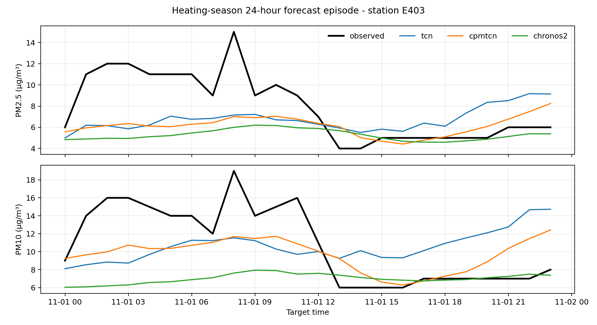
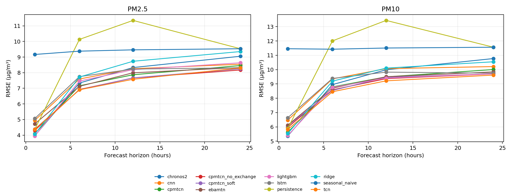
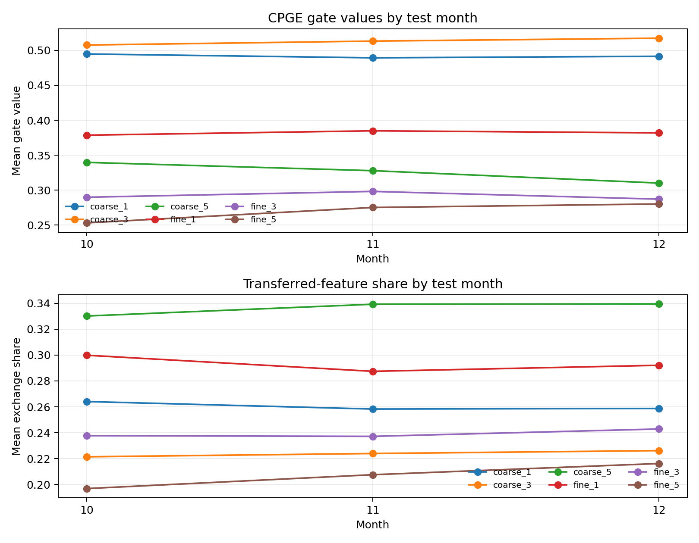
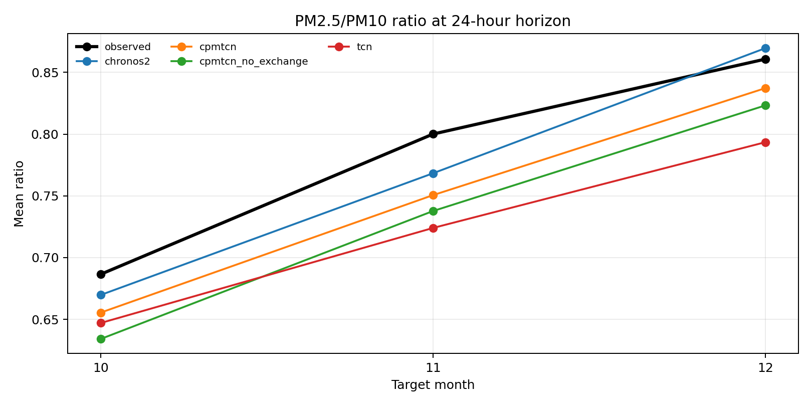

# Technical report: PM2.5 and PM10 forecasting

This report contains the five tables and four figures predeclared in the project proposal. All values come from cached test forecasts on the shared October-December 2025 origins. Neural results use seeds 42 and 123; fixed baselines retain their single configured run.

## Table 1. Overall accuracy

Metrics are arithmetic means across the reported 1, 6, 12 and 24-hour horizons. `skill_mean` is relative to persistence.

| model              | pollutant | runs | mae_mean | rmse_mean | r2_mean | bias_mean | skill_mean |
| --- | --- | --- | --- | --- | --- | --- | --- |
| tcn                | PM10      | 2    | 5.477    | 8.276     | 0.568   | 0.084     | 0.198      |
| lightgbm           | PM10      | 1    | 5.338    | 8.322     | 0.558   | -1.034    | 0.203      |
| cpmtcn_no_exchange | PM10      | 2    | 5.627    | 8.406     | 0.554   | -0.282    | 0.184      |
| cpmtcn_soft        | PM10      | 2    | 5.595    | 8.447     | 0.551   | -0.089    | 0.178      |
| cpmtcn             | PM10      | 2    | 5.670    | 8.479     | 0.543   | -0.157    | 0.185      |
| ebamtn             | PM10      | 2    | 5.691    | 8.542     | 0.540   | -0.247    | 0.170      |
| chronos2           | PM10      | 1    | 5.739    | 8.769     | 0.504   | -0.668    | 0.167      |
| ridge              | PM10      | 1    | 5.623    | 8.845     | 0.498   | -1.590    | 0.158      |
| lstm               | PM10      | 2    | 6.091    | 8.900     | 0.504   | 0.721     | 0.129      |
| cnn                | PM10      | 2    | 6.115    | 9.026     | 0.487   | 1.243     | 0.123      |
| persistence        | PM10      | 1    | 6.919    | 10.725    | 0.245   | -0.112    | 0.000      |
| seasonal_naive     | PM10      | 1    | 7.778    | 11.488    | 0.191   | -0.162    | -0.188     |
| cpmtcn_no_exchange | PM2.5     | 2    | 4.308    | 6.766     | 0.622   | -0.737    | 0.200      |
| tcn                | PM2.5     | 2    | 4.310    | 6.789     | 0.620   | -0.588    | 0.195      |
| cpmtcn_soft        | PM2.5     | 2    | 4.339    | 6.801     | 0.618   | -0.575    | 0.193      |
| cpmtcn             | PM2.5     | 2    | 4.421    | 6.895     | 0.603   | -0.541    | 0.194      |
| ebamtn             | PM2.5     | 2    | 4.422    | 7.043     | 0.593   | -1.398    | 0.159      |
| lightgbm           | PM2.5     | 1    | 4.305    | 7.059     | 0.581   | -1.545    | 0.183      |
| chronos2           | PM2.5     | 1    | 4.557    | 7.167     | 0.566   | -0.592    | 0.172      |
| cnn                | PM2.5     | 2    | 4.701    | 7.334     | 0.560   | 0.172     | 0.124      |
| lstm               | PM2.5     | 2    | 4.700    | 7.339     | 0.561   | -0.777    | 0.120      |
| ridge              | PM2.5     | 1    | 4.542    | 7.467     | 0.528   | -1.789    | 0.139      |
| persistence        | PM2.5     | 1    | 5.531    | 8.844     | 0.327   | -0.094    | 0.000      |
| seasonal_naive     | PM2.5     | 1    | 6.150    | 9.384     | 0.303   | -0.152    | -0.215     |

## Table 2. RMSE by forecast horizon

Values are seed means in µg/m³.

| model              | PM10 1h | PM10 6h | PM10 12h | PM10 24h | PM2.5 1h | PM2.5 6h | PM2.5 12h | PM2.5 24h |
| --- | --- | --- | --- | --- | --- | --- | --- | --- |
| chronos2           | 5.363   | 8.954   | 9.988    | 10.772   | 3.950    | 7.339    | 8.328     | 9.051     |
| cnn                | 6.472   | 9.352   | 10.068   | 10.212   | 4.946    | 7.595    | 8.255     | 8.540     |
| cpmtcn             | 5.627   | 8.792   | 9.493    | 10.005   | 4.095    | 7.162    | 7.868     | 8.456     |
| cpmtcn_no_exchange | 5.968   | 8.588   | 9.366    | 9.703    | 4.305    | 6.924    | 7.663     | 8.172     |
| cpmtcn_soft        | 6.077   | 8.545   | 9.460    | 9.708    | 4.385    | 6.905    | 7.665     | 8.250     |
| ebamtn             | 6.119   | 8.704   | 9.503    | 9.842    | 4.721    | 7.126    | 7.993     | 8.333     |
| lightgbm           | 5.401   | 8.766   | 9.402    | 9.716    | 3.947    | 7.463    | 8.194     | 8.632     |
| lstm               | 6.641   | 9.383   | 9.824    | 9.754    | 5.063    | 7.747    | 8.232     | 8.314     |
| persistence        | 5.895   | 12.007  | 13.435   | 11.563   | 4.368    | 10.130   | 11.345    | 9.532     |
| ridge              | 5.535   | 9.196   | 10.104   | 10.546   | 4.062    | 7.723    | 8.731     | 9.352     |
| seasonal_naive     | 11.458  | 11.424  | 11.507   | 11.563   | 9.166    | 9.378    | 9.462     | 9.532     |
| tcn                | 5.817   | 8.454   | 9.215    | 9.618    | 4.366    | 6.905    | 7.578     | 8.305     |

## Table 3. Peak-event error and bias

Targets above each station and pollutant's training 90th percentile define peak events. Values are averaged across horizons and seeds; the complete horizon-level table is `outputs/peak_metrics.csv`.

| model              | pollutant | horizons | peak_mae_mean | peak_bias_mean |
| --- | --- | --- | --- | --- |
| cnn                | PM10      | 4        | 15.095        | -9.457         |
| tcn                | PM10      | 4        | 15.747        | -13.518        |
| lstm               | PM10      | 4        | 15.990        | -13.752        |
| chronos2           | PM10      | 4        | 16.241        | -14.167        |
| cpmtcn             | PM10      | 4        | 16.314        | -14.264        |
| ebamtn             | PM10      | 4        | 16.413        | -14.671        |
| cpmtcn_soft        | PM10      | 4        | 16.782        | -14.959        |
| cpmtcn_no_exchange | PM10      | 4        | 16.873        | -15.678        |
| persistence        | PM10      | 4        | 17.632        | -13.709        |
| lightgbm           | PM10      | 4        | 17.916        | -16.930        |
| seasonal_naive     | PM10      | 4        | 17.948        | -14.019        |
| ridge              | PM10      | 4        | 20.515        | -19.703        |
| chronos2           | PM2.5     | 4        | 11.700        | -9.286         |
| cnn                | PM2.5     | 4        | 12.095        | -7.356         |
| tcn                | PM2.5     | 4        | 12.276        | -10.678        |
| cpmtcn             | PM2.5     | 4        | 12.411        | -10.604        |
| cpmtcn_soft        | PM2.5     | 4        | 12.442        | -10.745        |
| cpmtcn_no_exchange | PM2.5     | 4        | 12.449        | -10.999        |
| lstm               | PM2.5     | 4        | 13.137        | -11.604        |
| ebamtn             | PM2.5     | 4        | 13.304        | -12.424        |
| persistence        | PM2.5     | 4        | 13.343        | -9.228         |
| seasonal_naive     | PM2.5     | 4        | 13.443        | -9.142         |
| lightgbm           | PM2.5     | 4        | 13.721        | -12.663        |
| ridge              | PM2.5     | 4        | 15.484        | -14.707        |

## Table 4. Cross-pollutant value

Negative `change_pct` means that adding the other fraction reduced RMSE. Statistical interpretation must use `outputs/cross_value/bootstrap_summary.csv`, which resamples whole test days.

| model | target | horizon | own_rmse | both_rmse | change_pct |
| --- | --- | --- | --- | --- | --- |
| cnn   | coarse | 1       | 2.980    | 3.004     | 0.864      |
| cnn   | coarse | 6       | 3.357    | 3.325     | -0.958     |
| cnn   | coarse | 12      | 3.496    | 3.501     | 0.162      |
| cnn   | coarse | 24      | 3.576    | 3.547     | -0.812     |
| lstm  | coarse | 1       | 2.932    | 2.930     | -0.041     |
| lstm  | coarse | 6       | 3.370    | 3.371     | 0.043      |
| lstm  | coarse | 12      | 3.480    | 3.514     | 0.988      |
| lstm  | coarse | 24      | 3.555    | 3.686     | 3.694      |
| tcn   | coarse | 1       | 2.925    | 2.902     | -0.805     |
| tcn   | coarse | 6       | 3.330    | 3.332     | 0.042      |
| tcn   | coarse | 12      | 3.483    | 3.523     | 1.150      |
| tcn   | coarse | 24      | 3.503    | 3.575     | 2.081      |
| cnn   | pm25   | 1       | 5.108    | 4.609     | -9.687     |
| cnn   | pm25   | 6       | 7.401    | 7.588     | 2.584      |
| cnn   | pm25   | 12      | 8.228    | 8.506     | 3.727      |
| cnn   | pm25   | 24      | 8.517    | 8.649     | 1.535      |
| lstm  | pm25   | 1       | 4.736    | 4.529     | -4.377     |
| lstm  | pm25   | 6       | 7.987    | 7.875     | -1.273     |
| lstm  | pm25   | 12      | 8.803    | 8.585     | -2.272     |
| lstm  | pm25   | 24      | 8.721    | 8.804     | 1.079      |
| tcn   | pm25   | 1       | 4.550    | 4.660     | 2.349      |
| tcn   | pm25   | 6       | 6.997    | 6.918     | -1.138     |
| tcn   | pm25   | 12      | 7.818    | 7.701     | -1.496     |
| tcn   | pm25   | 24      | 8.265    | 8.161     | -1.263     |

## Table 5. CP-MTCN variants

RMSE deltas are paired whole-day-bootstrap comparisons in µg/m³. Negative values favor the first named strategy.

| comparison         | seed | pollutant | horizon | rmse_delta | ci_low | ci_high |
| --- | --- | --- | --- | --- | --- | --- |
| full - no exchange | 42   | PM2.5     | 1       | -0.285     | -0.390 | -0.191  |
| full - no exchange | 42   | PM2.5     | 6       | 0.300      | 0.060  | 0.544   |
| full - no exchange | 42   | PM2.5     | 12      | 0.275      | 0.029  | 0.528   |
| full - no exchange | 42   | PM2.5     | 24      | 0.524      | 0.245  | 0.817   |
| full - no exchange | 42   | PM10      | 1       | -0.502     | -0.623 | -0.381  |
| full - no exchange | 42   | PM10      | 6       | 0.183      | -0.084 | 0.469   |
| full - no exchange | 42   | PM10      | 12      | 0.095      | -0.193 | 0.381   |
| full - no exchange | 42   | PM10      | 24      | 0.350      | 0.032  | 0.670   |
| full - no exchange | 123  | PM2.5     | 1       | -0.136     | -0.238 | -0.033  |
| full - no exchange | 123  | PM2.5     | 6       | 0.177      | -0.052 | 0.405   |
| full - no exchange | 123  | PM2.5     | 12      | 0.135      | -0.113 | 0.378   |
| full - no exchange | 123  | PM2.5     | 24      | 0.043      | -0.255 | 0.353   |
| full - no exchange | 123  | PM10      | 1       | -0.180     | -0.272 | -0.083  |
| full - no exchange | 123  | PM10      | 6       | 0.224      | -0.015 | 0.442   |
| full - no exchange | 123  | PM10      | 12      | 0.160      | -0.107 | 0.434   |
| full - no exchange | 123  | PM10      | 24      | 0.255      | -0.050 | 0.583   |
| soft - hard        | 42   | PM2.5     | 1       | 0.388      | 0.243  | 0.563   |
| soft - hard        | 42   | PM10      | 1       | 0.723      | 0.526  | 0.934   |
| soft - hard        | 42   | PM2.5     | 6       | -0.285     | -0.530 | -0.050  |
| soft - hard        | 42   | PM10      | 6       | -0.334     | -0.632 | -0.048  |
| soft - hard        | 42   | PM2.5     | 12      | -0.294     | -0.543 | -0.046  |
| soft - hard        | 42   | PM10      | 12      | 0.010      | -0.362 | 0.392   |
| soft - hard        | 42   | PM2.5     | 24      | -0.475     | -0.772 | -0.163  |
| soft - hard        | 42   | PM10      | 24      | -0.460     | -0.771 | -0.142  |
| soft - hard        | 123  | PM2.5     | 1       | 0.193      | 0.102  | 0.291   |
| soft - hard        | 123  | PM10      | 1       | 0.178      | 0.048  | 0.315   |
| soft - hard        | 123  | PM2.5     | 6       | -0.229     | -0.425 | -0.040  |
| soft - hard        | 123  | PM10      | 6       | -0.161     | -0.387 | 0.045   |
| soft - hard        | 123  | PM2.5     | 12      | -0.112     | -0.319 | 0.082   |
| soft - hard        | 123  | PM10      | 12      | -0.076     | -0.305 | 0.149   |
| soft - hard        | 123  | PM2.5     | 24      | 0.063      | -0.217 | 0.332   |
| soft - hard        | 123  | PM10      | 24      | -0.134     | -0.440 | 0.186   |

## Efficiency appendix

Neural timings are end-to-end batched inference on the RTX 3050 and include decoding and transfer of predictions back to the CPU. Classical timings cover all eight pollutant/horizon estimators. A station-origin is one 24-hour, two-pollutant forecast request.

| model              | units_label           | runs | parameters_or_units | training_seconds_mean | milliseconds_per_sample_mean | peak_gpu_memory_mb_mean |
| --- | --- | --- | --- | --- | --- | --- |
| chronos2           | pretrained parameters | 1    | 120000000.000       | 0.000                 | 24.291                       |                         |
| cnn                | trainable parameters  | 2    | 47448.000           | 63.765                | 0.041                        | 66.342                  |
| cpmtcn             | trainable parameters  | 2    | 248502.000          | 347.317               | 0.174                        | 117.263                 |
| cpmtcn_no_exchange | trainable parameters  | 2    | 248502.000          | 199.950               | 0.145                        | 97.242                  |
| cpmtcn_soft        | trainable parameters  | 2    | 248502.000          | 342.822               | 0.263                        | 117.245                 |
| ebamtn             | trainable parameters  | 2    | 340491.000          | 155.492               | 0.084                        | 264.368                 |
| lightgbm           | tree leaves           | 1    | 74400.000           | 32.535                | 0.090                        | 0.000                   |
| lstm               | trainable parameters  | 2    | 59864.000           | 48.403                | 0.023                        | 168.191                 |
| persistence        | parameters            | 1    | 0.000               | 0.000                 |                              | 0.000                   |
| ridge              | coefficients          | 1    | 440.000             | 0.676                 | 0.002                        | 0.000                   |
| seasonal_naive     | parameters            | 1    | 0.000               | 0.000                 |                              | 0.000                   |
| tcn                | trainable parameters  | 2    | 90840.000           | 99.543                | 0.069                        | 86.772                  |

Full station-level and month-level accuracy are available in `outputs/per_station_metrics.csv` and `outputs/monthly_metrics.csv`.

## Figure 1. Heating-season forecast episode

## Figure 2. Error versus forecast horizon

## Figure 3. CPGE gates and exchange share by month

## Figure 4. PM2.5/PM10 ratio by month

The additional hour-of-day gate and exchange-share diagnostic is available as `figures/cpge_gates_by_hour.png`.

## Main findings

- LightGBM gives the lowest one-hour PM2.5 RMSE; zero-shot Chronos-2 gives the lowest one-hour PM10 RMSE.
- TCN is the strongest general trained model and leads PM10 at 6, 12 and 24 hours.
- CPGE improves both pollutants at one hour in both seeds, but the longer-horizon effect is not stable.
- The hard output has zero PM2.5-above-PM10 violations. The soft output trades occasional violations for some medium- and long-horizon gains.
- The controlled value experiment finds one cross-seed robust improvement: adding coarse history to the CNN PM2.5 model at one hour.

## Scope and limitations

The test block covers one autumn-to-winter transition. The project uses past weather rather than operational future weather forecasts, two neural seeds, point predictions, and station embeddings without a geographic graph. Granger-style tests describe incremental predictive information and do not establish causality.

## References

1. Vrbancic, G. *Air quality dataset*, Mendeley Data v2. DOI: 10.17632/p86hnykz3d.2.
2. Xie, Z.-A. et al. *Multi-pollutant air quality forecasting using bidirectional attention and multi-scale temporal networks*. Frontiers in Environmental Science 13:1623630, 2025.
3. Lu, J. and Sun, S. *A causality-aware spatiotemporal model for multi-region and multi-pollutant air quality forecasting*. arXiv:2509.21260, 2025.
4. Badouch, A. and Belhoucine, K. *Benchmarking Deep Learning for PM2.5 Forecasting in IoT-Based Smart Cities*. IJACSA 17(5), 2026.
5. Ansari, A. F. et al. *Chronos-2: From Univariate to Universal Forecasting*. arXiv:2510.15821, 2025.
